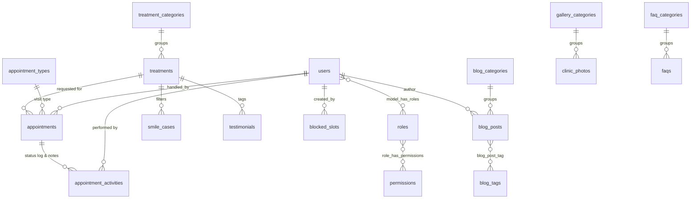

# Munjir Dental Care — website, booking system & admin

Laravel 12 + MySQL/MariaDB conversion of the original static site (kept in git history on `main`).
The public design, CSS, GSAP animations and sliders are the original ones; content now comes from the database.

- **Public site:** `/` · `/treatments` · `/treatments/{slug}` · `/blog` · `/blog/{slug}` · `/privacy-policy` · `/terms-of-use` · `/sitemap.xml` · `/robots.txt`
- **Admin:** `/admin` (Super Admin, Receptionist and Content Manager roles; permissions are checked on every request)

## Local setup (XAMPP)

```bash
composer install
cp .env.example .env        # then set APP_ENV=local, APP_DEBUG=true, DB_*, ADMIN_EMAIL/ADMIN_PASSWORD
php artisan key:generate
php artisan migrate --seed  # roles, admin user, schedule and the content of the original site
php artisan storage:link
php artisan serve           # http://127.0.0.1:8000  — admin at /admin
php artisan test            # needs an empty database named munjir_dental_test
```

Mail is logged to `storage/logs` when `MAIL_MAILER=log`.

## Architecture

```
app/Services/Booking/AvailabilityService.php  slots = sessions − breaks − closures − blocked − booked − window/notice
app/Services/Booking/BookingService.php       the only code that creates/changes appointments
app/Enums/AppointmentStatus.php               states + allowed transitions
app/Services/ImageService.php                 uploads → responsive WebP variants (strips EXIF)
app/Services/Settings.php + config/settings.php   every editable setting: schema, validation, defaults
app/Services/HtmlCleaner.php                  sanitises rich text before saving
config/admin-menu.php                         admin sidebar (filtered by permission)
config/icons.php                              icons admins may choose (the public icon font is a subset)
```

### Database (ERD)



Standalone tables: `dentist_profiles` (one row), `credentials` (education, registration, experience, certification,
training, workshop, achievement), `highlights` ("why choose me"), `schedule_sessions`, `schedule_breaks`,
`unavailable_dates`, `contact_messages`, `newsletter_subscribers`, `settings` (key/value).

### Double-booking protection

1. Availability is recalculated on the server for every request — never cached.
2. `BookingService` locks the day's appointment rows (`SELECT … FOR UPDATE`) inside a transaction, re-checks the slot, then inserts.
3. `appointments.slot_key` (`"Y-m-d H:i"`, NULL once cancelled/rejected) has a **unique index**, so the database itself refuses a second booking for the same slot.

In-clinic, phone and video visits share one slot pool (one doctor). Each booking takes one slot of the configured length.

### Content rules

- Testimonials and smile-gallery cases can only be published after patient consent is recorded (enforced on the server).
- Nothing patient-related is seeded. Empty sections hide themselves (gallery, blog, FAQ) or show an invitation (reviews).
- Rich text is sanitised on save; all other output is escaped by Blade.

## Front-end build tools (only when changing CSS/icons)

| When you change… | Run |
|---|---|
| `public/assets/css/style.css` / `responsive.css` | `node tools/build-css.cjs` |
| Bootstrap classes used in public Blade views | `node tools/purge-css.cjs && node tools/build-css.cjs` |
| a `bi-*` icon in a public view, the JS or `config/icons.php` | `python tools/build_icons.py && node tools/build-css.cjs` |
| admin vendor libraries (`npm update`) | `npm run build:admin` |

`npm install` installs the tools. Built files are committed, so the server needs no Node.

## Production deployment

1. PHP 8.2+ (extensions: pdo_mysql, mbstring, gd, intl, fileinfo, zip), MySQL 8+ / MariaDB 10.6+, HTTPS.
2. Point the web root at **`public/`** (on cPanel: upload the project above `public_html` and point the domain there).
3. `composer install --no-dev --optimize-autoloader`
4. Fill `.env` from `.env.example` (`APP_ENV=production`, `APP_DEBUG=false`, real `APP_URL`, DB, SMTP, `ADMIN_EMAIL`).
5. ```bash
   php artisan key:generate
   php artisan migrate --force --seed
   php artisan storage:link
   php artisan config:cache && php artisan route:cache && php artisan view:cache
   ```
6. Cron (every minute) — sends queued booking emails:
   `* * * * * cd /path/to/project && php artisan schedule:run >> /dev/null 2>&1`
7. Sign in at `/admin`, change the seeded password, then fill in **Website Settings** (email, socials,
   booking alert emails), **SEO**, **Legal pages**, and the real Google rating if you want it shown.
8. Submit `https://your-domain/sitemap.xml` in Google Search Console.

After each deployment: `php artisan migrate --force && php artisan optimize`.
